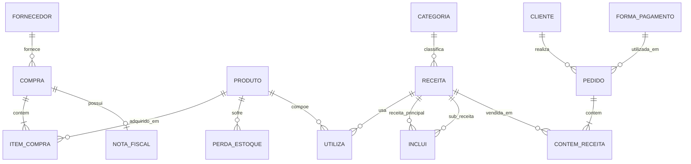

# Modelagem conceitual

O modelo conceitual representa o domínio do KitchenOS sem depender de um
SGBD. Ele possui 14 entidades, relacionamentos associativos para compras,
composição de receitas e itens de pedidos, além do autorrelacionamento que
permite usar uma receita como sub-receita de outra.

## Regras representadas

- Um fornecedor pode fornecer várias compras; cada compra pertence a um
  fornecedor.
- Uma compra possui um ou mais itens e pode possuir uma nota fiscal.
- Um produto pode aparecer em compras, receitas e registros de perda.
- Cada receita pertence a uma categoria, utiliza produtos e pode incluir
  outras receitas.
- Um cliente pode realizar vários pedidos; cada pedido registra uma forma de
  pagamento e contém uma ou mais receitas.

O arquivo-fonte editável criado no BrModelo também está disponível em
[`LOGICO_1.brM`](../LOGICO_1.brM).
