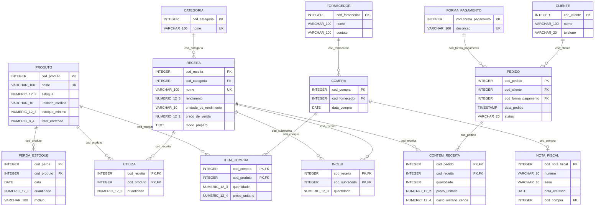

# Modelagem lógica

O modelo lógico abaixo é a tradução relacional da modelagem conceitual. As
chaves compostas das tabelas associativas impedem a repetição do mesmo item
dentro de uma compra, receita ou pedido.

O DDL correspondente está em
[`database/ddl/01_create_tables.sql`](../database/ddl/01_create_tables.sql).
