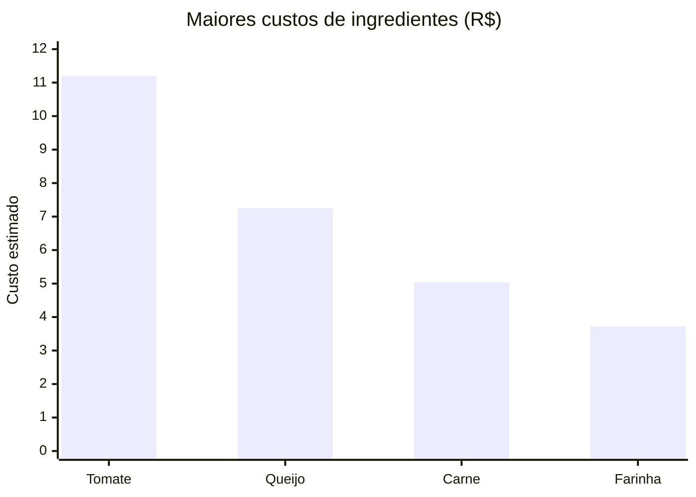
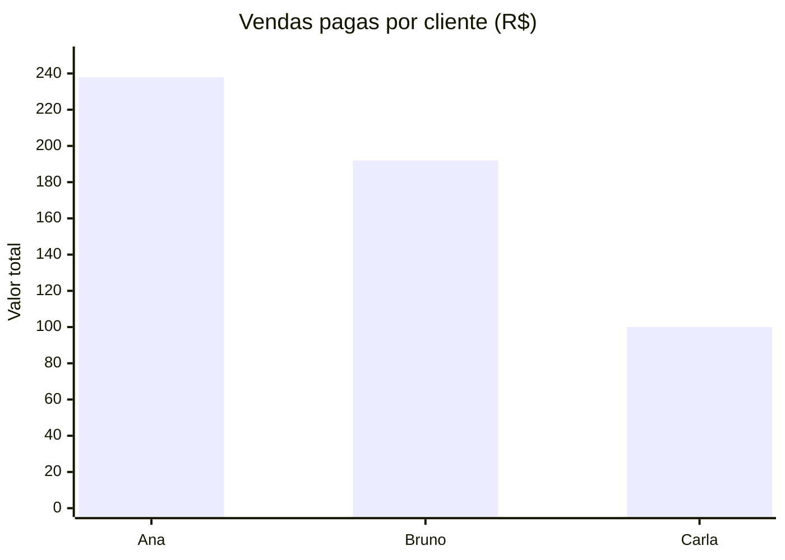
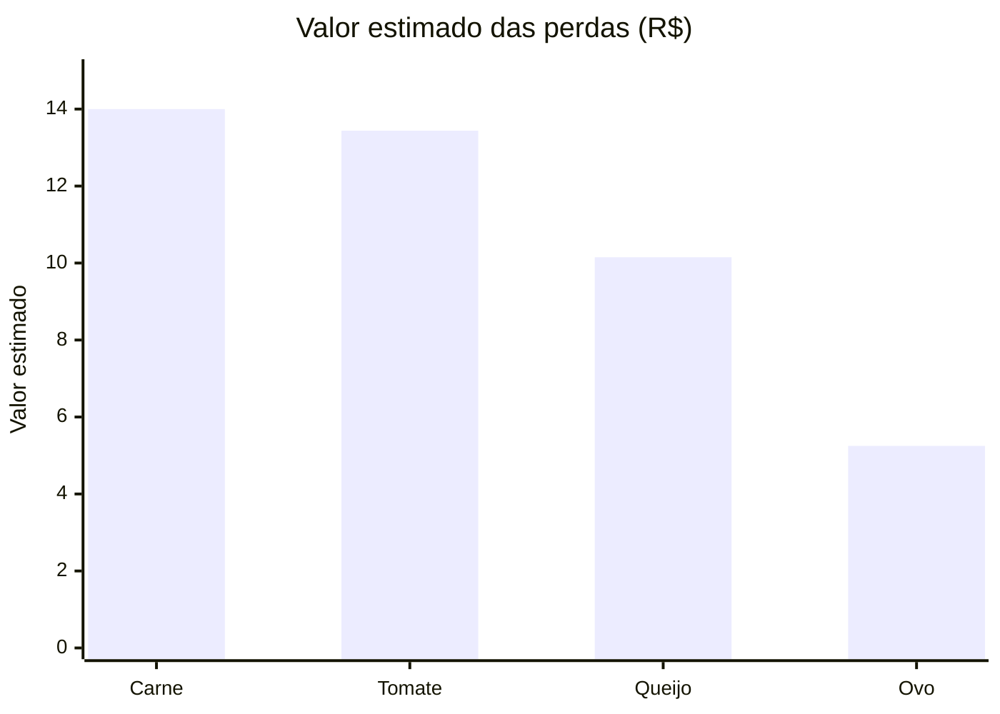

# KitchenOS — Sistema de Gestão para Restaurantes

**Trabalho Final — Banco de Dados I (DEC7129)**  
**Professor:** Alexandre Leopoldo Gonçalves  
**Instituição:** Universidade Federal de Santa Catarina — Campus Araranguá  
**Semestre:** 2026.2  
**Integrante(s):** preencher antes da entrega  
**Data:** novembro de 2026

## Sumário

1. [Objetivo geral](#1-objetivo-geral)
2. [Descrição detalhada e requisitos](#2-descrição-detalhada-e-requisitos)
3. [Modelagem conceitual](#3-modelagem-conceitual)
4. [Modelagem lógica](#4-modelagem-lógica)
5. [Script DDL](#5-script-ddl)
6. [Consultas de sumarização](#6-consultas-de-sumarização)
7. [Aplicação desenvolvida](#7-aplicação-desenvolvida)

## 1. Objetivo geral

O KitchenOS tem como objetivo apoiar a gestão integrada de um restaurante por
meio de um banco de dados relacional. O sistema centraliza produtos,
fornecedores, compras e perdas de estoque, permitindo conhecer a origem e o
custo dos insumos. Também mantém receitas, ingredientes, sub-receitas,
categorias e preços de venda, formando fichas técnicas úteis para produção e
análise de rentabilidade. Clientes, pedidos, formas de pagamento e itens
vendidos completam o fluxo operacional. Sobre esses dados, a aplicação oferece
CRUD, consultas analíticas, gráficos e recursos de IA generativa para apoiar a
busca de informações e a tomada de decisão.

## 2. Descrição detalhada e requisitos

O restaurante precisa controlar os insumos usados no preparo dos pratos. Cada
produto possui nome, unidade de medida, saldo em estoque, estoque mínimo e
fator de correção, empregado para representar perdas naturais de limpeza e
preparo. Os produtos são adquiridos de fornecedores. Uma compra identifica o
fornecedor e a data, enquanto seus itens registram cada produto, quantidade e
preço unitário. Uma compra pode ter uma nota fiscal, identificada por número,
série e data de emissão. Esse histórico permite calcular preços médios sem
substituir os valores das compras anteriores.

Perdas de estoque precisam ser registradas separadamente, com produto, data,
quantidade e motivo. Assim, o restaurante consegue identificar desperdícios,
vencimentos ou falhas de armazenamento e estimar o impacto financeiro usando o
histórico de compras. O saldo atual permanece no cadastro do produto. Nesta
versão acadêmica ele é informado pelo usuário, pois a atualização automática
por gatilhos não faz parte do escopo adotado.

As receitas são organizadas por categorias e possuem nome, rendimento, unidade
de rendimento, preço de venda e modo de preparo. A composição direta é formada
por produtos e suas quantidades. Como preparações podem depender de outras
preparações, uma receita também pode incluir sub-receitas, com a quantidade
necessária de cada uma. A aplicação percorre essa hierarquia para produzir uma
ficha técnica expandida e estimar o custo com base nos preços de compra.

No processo de venda, clientes realizam pedidos e escolhem uma forma de
pagamento. Cada pedido registra data, situação e uma ou mais receitas vendidas.
O item do pedido mantém a quantidade, o preço efetivamente praticado e um
snapshot do custo unitário no momento da venda. Isso preserva o histórico mesmo
se o preço da receita ou dos ingredientes mudar posteriormente. Pedidos
cancelados continuam armazenados para rastreabilidade, mas são desconsiderados
nas consultas de faturamento.

A aplicação deve permitir inclusão, consulta, alteração e exclusão de registros
nas 14 tabelas do modelo, respeitando chaves primárias, estrangeiras e demais
restrições. Também deve criar as tabelas e carregar dados iniciais em um banco
vazio, bem como eliminar todas as tabelas mediante confirmação explícita. Três
consultas acadêmicas devem executar SQL real, exibir os dados em tabela e gerar
gráficos. O painel principal reúne essas operações em uma interface web.

Para integrar IA, as receitas são convertidas em embeddings multilíngues de 384
dimensões. A busca semântica usa similaridade de cosseno, e uma projeção PCA
permite explorar visualmente as relações entre receitas e perguntas. O chat com
Gemini recebe uma cópia controlada dos dados e não tem permissão para executar
SQL ou alterar o banco. Perguntas, respostas e referências recuperadas são
armazenadas para auditoria.

Requisitos não funcionais importantes incluem integridade referencial,
validação de quantidades e valores, preservação de credenciais fora do Git,
consultas analíticas somente leitura e mensagens claras quando o PostgreSQL não
está disponível. O projeto usa PostgreSQL, FastAPI, React e TypeScript.

## 3. Modelagem conceitual

A modelagem conceitual contém as 14 entidades exigidas, suas cardinalidades e
o autorrelacionamento de receitas. O diagrama completo e as regras de negócio
estão em [Modelagem conceitual](modelagem-conceitual.md).

## 4. Modelagem lógica

A transformação para o modelo relacional define atributos, tipos, chaves
primárias simples e compostas e chaves estrangeiras. O diagrama completo está
em [Modelagem lógica](modelagem-logica.md), e o arquivo editável do BrModelo
está em [`LOGICO_1.brM`](../LOGICO_1.brM).

## 5. Script DDL

O script PostgreSQL que materializa o modelo lógico, com 14 tabelas,
restrições `PRIMARY KEY`, `FOREIGN KEY`, `UNIQUE`, `NOT NULL` e `CHECK`, está em
[`database/ddl/01_create_tables.sql`](../database/ddl/01_create_tables.sql).

## 6. Consultas de sumarização

### 6.1 Custo dos ingredientes por receita

**Objetivo:** calcular o preço médio histórico de cada ingrediente e seu custo
estimado na receita. A consulta envolve `receita`, `utiliza`, `produto` e
`item_compra`, usando `AVG`.

SQL: [`01_custos_receitas.sql`](../database/queries/01_custos_receitas.sql)

| Receita | Ingrediente | Quantidade | Preço médio | Custo estimado |
|---|---|---:|---:|---:|
| Molho de tomate | Tomate | 2,000 | R$ 5,6000 | R$ 11,2000 |
| Pizza marguerita | Queijo muçarela | 0,250 | R$ 29,0000 | R$ 7,2500 |
| Hambúrguer artesanal | Carne bovina moída | 0,180 | R$ 28,0000 | R$ 5,0400 |
| Massa de pizza | Farinha de trigo | 0,800 | R$ 4,6500 | R$ 3,7200 |

### 6.2 Vendas pagas por cliente

**Objetivo:** sumarizar pedidos pagos, itens comprados e valor total por
cliente. A consulta envolve `cliente`, `pedido`, `forma_pagamento` e
`contem_receita`, usando `COUNT` e `SUM`.

SQL: [`02_vendas.sql`](../database/queries/02_vendas.sql)

| Cliente | Pedidos pagos | Itens comprados | Valor total |
|---|---:|---:|---:|
| Ana Souza | 2 | 5 | R$ 238,00 |
| Bruno Lima | 2 | 5 | R$ 192,00 |
| Carla Mendes | 1 | 3 | R$ 100,00 |

### 6.3 Valor das perdas de estoque

**Objetivo:** consolidar a quantidade perdida por produto e estimar seu valor
com o preço médio de compra. A consulta envolve `perda_estoque`, `produto` e
`item_compra`, usando `AVG`, `SUM` e `MAX`.

SQL: [`03_estoque_perdas.sql`](../database/queries/03_estoque_perdas.sql)

| Produto | Quantidade perdida | Preço médio | Valor estimado |
|---|---:|---:|---:|
| Carne bovina moída | 0,500 | R$ 28,0000 | R$ 14,00 |
| Tomate | 2,400 | R$ 5,6000 | R$ 13,44 |
| Queijo muçarela | 0,350 | R$ 29,0000 | R$ 10,15 |
| Ovo | 6,000 | R$ 0,8750 | R$ 5,25 |

As tabelas e os gráficos também são produzidos dinamicamente na área
**Analytics SQL** da aplicação, usando os resultados atuais do PostgreSQL.

## 7. Aplicação desenvolvida

A aplicação atende ao item 7 do enunciado com:

- conexão com PostgreSQL por `psycopg2`;
- CRUD genérico nas 14 tabelas, inclusive chaves compostas;
- execução somente leitura das três consultas e gráficos de barras;
- menu web com estoque, fichas técnicas, vendas, perdas, dados, analytics,
  embeddings, chat e administração;
- criação, carga inicial e eliminação protegida das tabelas;
- embeddings reais, busca semântica, projeção PCA e chat integrado ao Gemini.

As instruções de instalação e execução estão no [README principal](../README.md).
